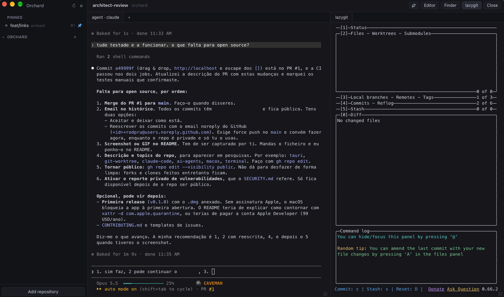

# Orchard

Run coding agents in parallel git worktrees, on macOS and Linux.



Each task gets its own worktree, and each worktree gets:

- an agent terminal running Claude Code, Codex, opencode or any other CLI;
- extra shells, as tabs;
- a lazygit pane next to it;
- the PR and CI status of its branch, from the `gh` CLI.

The sidebar shows which agents are busy, which have new output and which rang the bell. Everything runs locally. Orchard is a desktop app built with [Tauri](https://tauri.app), Rust and React.

## Requirements

- macOS, or Linux. The `.deb` is for Ubuntu 22.04+ and Debian 12+ on x86_64; on other distributions, [build from source](#build-from-source).
- The agent CLI you want to use, for example `claude`

The Homebrew cask installs `lazygit` and `gh` for you. The `.deb` recommends both, so apt installs them where your distribution packages them: `gh` on every supported release, `lazygit` on Debian 13 and Ubuntu 25.04 or later. Otherwise, install `lazygit` with Homebrew or from its [install guide](https://github.com/jesseduffield/lazygit#installation); if it is missing, the lazygit pane says so. Either way, run `gh auth login` once.

## Install

### macOS

```bash
brew install --cask rodpru/tap/orchard
```

Orchard is not notarized by Apple. The cask removes the quarantine flag after install, so macOS opens the app without a Gatekeeper prompt. Install it only if you trust the [tap](https://github.com/rodpru/homebrew-tap).

### Linux (Debian, Ubuntu)

```bash
curl -fLO https://github.com/rodpru/orchard/releases/latest/download/orchard_amd64.deb
sudo apt install ./orchard_amd64.deb
```

This adds Orchard to the application launcher and `orchard` to your PATH. apt installs WebKitGTK and GTK if they are missing. `sudo apt remove orchard` uninstalls it.

If the window stays blank, try starting it with `WEBKIT_DISABLE_COMPOSITING_MODE=1 orchard`. Orchard already turns off WebKitGTK's DMA-BUF renderer, the usual cause on NVIDIA and some Wayland setups.

### Build from source

You need Rust (via [rustup](https://rustup.rs)), Node and pnpm. On Linux you also need the WebKitGTK headers; on Debian or Ubuntu:

```bash
sudo apt install build-essential pkg-config libwebkit2gtk-4.1-dev libgtk-3-dev librsvg2-dev libsoup-3.0-dev
```

For other distributions, see the [Tauri prerequisites](https://v2.tauri.app/start/prerequisites/#linux). Then:

```bash
git clone https://github.com/rodpru/orchard.git
cd orchard
pnpm install
pnpm tauri build
```

On macOS, copy the app with `cp -R src-tauri/target/release/bundle/macos/Orchard.app /Applications/`; the build also produces a `.dmg` in `src-tauri/target/release/bundle/dmg/`. On Linux, install it with `sudo apt install ./src-tauri/target/release/bundle/deb/*.deb`. On distributions without apt, run the binary `src-tauri/target/release/orchard` directly.

### Updates

Orchard checks GitHub Releases for a new version 30 seconds after launch and every six hours. On macOS it installs the update in the background, and you get it the next time you open Orchard; running agents are never interrupted. On Linux, an **Update available** button appears in the sidebar and opens the release page; install the new `.deb` with `sudo apt install ./orchard_amd64.deb`. The same button appears on macOS when Orchard's folder isn't writable by your user; update with `brew upgrade --cask --greedy rodpru/tap/orchard`. If a check fails for any reason other than being offline, Settings shows why. To turn this off, untick **Update automatically** in Settings.

## Use

1. Click **Add repository** and pick a git repository.
2. Press `⌘N` (Linux: `Ctrl+Shift+N`) to create a worktree. Give it a branch name and, if the branch is new, the base to start from.
3. The agent starts in the new worktree. Open more shells with `+`, and push and open a PR with **Create PR**.
4. When the task is done, **Remove** deletes the worktree. Orchard asks whether to also delete the local branch; it never deletes the remote branch.

### Open a worktree from the terminal

The Homebrew cask and the `.deb` put `orchard` on your PATH. If you built the macOS app from source, link it yourself:

```bash
ln -s /Applications/Orchard.app/Contents/MacOS/orchard /opt/homebrew/bin/orchard
```

Then:

```bash
orchard .
```

`orchard <path>` registers the repository that contains `<path>` and opens its worktree.

### Shortcuts

| | macOS | Linux |
| --- | --- | --- |
| New worktree in the current repository | `⌘N` | `Ctrl+Shift+N` |
| Switch between open worktrees | `⌘1`…`⌘9` | `Ctrl+Shift+1`…`9` |
| Copy and paste in a terminal | `⌘C`, `⌘V` | `Ctrl+Shift+C`, `Ctrl+Shift+V` |
| Newline in agent prompts | `Shift+Enter` | `Shift+Enter` |

## Where things live

- **Config:** `~/Library/Application Support/io.github.rodpru.orchard/config.json` on macOS, `~/.config/io.github.rodpru.orchard/config.json` on Linux. If it cannot be parsed, it is moved to `config.json.corrupt-<timestamp>` and Orchard starts with defaults.
- **Terminals:** owned by the app, not the window. Closing a tab or a worktree view stops its processes; reloading the window does not. Quitting Orchard stops all of them.
- **New worktrees:** `<repo>.worktrees/<branch>` next to the repository, or `<folder>/<repo>/<branch>` when a worktree folder is set in Settings.

## Develop

```bash
pnpm install
pnpm tauri dev
```

Checks, also run in CI:

```bash
pnpm exec tsc --noEmit && pnpm lint && pnpm test
cd src-tauri && cargo fmt --check && cargo clippy --all-targets -- -D warnings && cargo test
```

IPC types in `src/lib/bindings/` are generated from the Rust structs. After changing one, run `pnpm gen:types` and commit the result.

## Security

Orchard runs the commands you configure, by design. See [SECURITY.md](SECURITY.md) for details and for how to report a vulnerability.

## License

[MIT](LICENSE)
